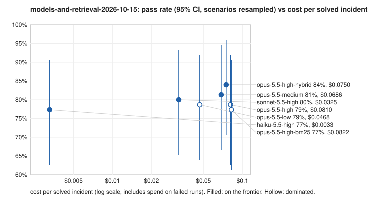
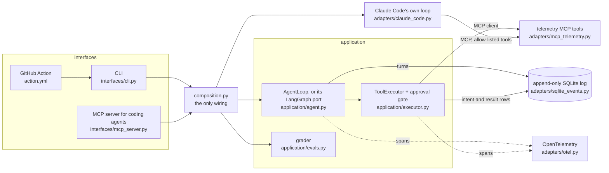

# rootcause

[](https://github.com/OrenSegal/rootcause/actions/workflows/ci.yml) [](LICENSE)

An eval harness for agents that diagnose failures, and a benchmark of real CI failures to run it on. Given a failed CI run, or an incident's logs, metrics, traces and deploy history, the agent returns a typed root-cause answer. The harness grades that answer against a known truth, runs every configuration several times, and reports accuracy with intervals that respect how few cases there are, next to what each correct answer cost.

The loop, tool gating, crash recovery and grader are written by hand, without an agent framework, so every behaviour is visible and tested.

## Did the change break the build?

<!-- DRAFT: held-out numbers are TODO until results/sweeps/ci-test-2026-11-23/ is committed. -->

[`benchmarks/ci/`](benchmarks/ci/README.md) holds 168 failed pull-request runs from 55 public Python repositories. Each case asks whether the change under test caused the failure and, if it did, which commit. 108 cases were caused by the change and 60 were not (flaky tests, network errors, runner faults, upstream releases). The split is by repository: 51 dev cases from 16 repositories, and 117 held-out cases from 39 others. The full write-up is [docs/ci-benchmark.md](docs/ci-benchmark.md).

- **The obvious answer is a trap.** Blaming the head commit finds the guilty commit in 94% of change cases and fails every case the change did not cause. Accuracy on each class is reported separately, with their mean.
- **The data leaks the class through the commit count.** Cases not caused by the change more often have several commits under test, and a rule that uses only that count scores 75% on the held-out set. Every comparison is also read on single-commit cases.
- **Model results on the held-out set:** TODO.
- **The triage ladder against the strongest model alone:** TODO. Free rules answer first, a cheap model takes what they leave, and the strong model runs only when a lint flags the cheap answer.

```bash
uv run rootcause eval benchmarks/ci/dev --provider rules --min-pass-rate 0
uv run rootcause diff results/sweeps/ci-test-2026-11-23:haiku-5.5-high-cite results/sweeps/ci-test-2026-11-23:opus-5.5-high-cite
uv run rootcause ladder results/sweeps/ci-test-2026-11-23 --cheap haiku-5.5-high-cite --strong opus-5.5-high-cite --out ladder.jsonl
```

The first runs the free rules on the dev cases; they abstain when no rule fires. The second asks whether Opus beat Haiku on the held-out set or the gap is noise: it pairs the runs by case and reports the gap, an interval, a sign test and the smallest gap this many cases could detect. The third replays the ladder from the finished sweep without calling a model.

The same rules run on your own repository as a GitHub Action. When CI fails, `OrenSegal/rootcause/triage` writes a verdict to the job summary: what failed, whether the change likely caused it, and the log lines behind it. It reads the run through a read-only token and never checks out the pull request. `OrenSegal/rootcause/diff` fails a job when a candidate eval result is a real regression against a baseline. Both are described in [docs/actions.md](docs/actions.md).

## What the incident evals found

- **Cost separated the models; accuracy did not.** Across 525 graded runs of seven settings, from Haiku 5.5 to Opus 5.5 at high effort, pass rates sat between 77% and 84% with overlapping intervals, while cost per solved incident ranged from $0.0033 to $0.081. With 25 incidents the design can only detect gaps above about 13 to 19 points, so smaller accuracy differences are unresolved, not zero.
- **Splitting the work tripled the cost.** An orchestrator with three workers cost about 3x a single agent per solved incident, with no detectable accuracy gain. The hand-written loop and a LangGraph port of it were indistinguishable on accuracy, cost and latency.
- **The suite could not catch a broken prompt.** Mutation testing the agent's brief (deleting an instruction, inverting a rule, planting a wrong fact) killed 0 of 12 mutants. A second suite built so each rule decides one scenario killed 2 of 14, and both kills came from the one rule the grader enforces directly. A strong model does the right thing without being told.
- **Outside incidents are harder.** On eight incidents adapted from public postmortems, with ground truth committed before any run, Haiku fell from 77% to 50%. It named the right service in 22 of 24 runs; most misses were the category.
- **A planted prompt injection never worked.** A log line telling automated responders to roll back an innocent deploy was ignored in all 21 runs, in a scenario where the operator approves rollbacks.



Pass rate with a 95% interval (incidents resampled, each incident's runs kept together) against cost per solved incident, log scale. Full tables, per-scenario failures and caveats are in [docs/results.md](docs/results.md).

## Try it

No API key needed for these:

```bash
uv sync
uv run rootcause investigate scenarios/005-inventory-bad-deploy
uv run rootcause report results/sweeps/models-and-retrieval-2026-10-15 --strict-service
uv run rootcause eval --min-pass-rate 0.05
```

The first runs the scripted baseline ("blame the last deploy before the first error") on an incident it gets right. The second recomputes the 525-run table and chart above from the committed rows. The third grades the baseline on all 33 scenarios; it solves 7, which is the point: the scenarios are built so the obvious answer is usually wrong.

[`micro/microagent.py`](micro/microagent.py) is the same idea in one file of stdlib Python: loop, approval gate, grader and interval.

To put a model in the loop:

| provider | what runs the loop | model access |
|---|---|---|
| `anthropic` | the hand-written loop | Messages API with native tool use (API key) |
| `claude-code-loop` | the hand-written loop | one structured completion per turn through headless Claude Code |
| `langgraph` | the same investigation as a LangGraph graph | as `claude-code-loop` |
| `claude-code` | Claude Code's own loop, given the telemetry tools over MCP | Claude Code |

```bash
uv run rootcause eval --provider claude-code --min-pass-rate 0
uv run rootcause investigate scenarios/007-inventory-timeout-cascade --provider claude-code-loop --mode multi
uv run rootcause sweep sweeps/models-and-retrieval.yaml --dry-run
```

## How grading works

Each scenario carries its ground truth: the category (bad deploy, config change, dependency failure, resource exhaustion, infrastructure, or no incident), the guilty service, and the telemetry ids that prove it. A run passes when it gets the category and service right, cites only ids that exist in the scenario with at least one being the expected evidence, rolled back nothing outside the root cause, and made at least one tool call. The grader does not read the written explanation.

A CI case is graded on class instead: caused by the change or not, plus the guilty commit for a change case. The report gives accuracy on each class and their mean, since the classes are unequal.

A sweep runs each configuration on every scenario several times, interleaved so rate limits or time of day do not land on one configuration, and resumes where it stopped. The report gives:

- a 95% interval from a cluster bootstrap over incidents, since repeats of one incident mostly agree (75 runs carry the information of about 30);
- pass^k (every attempt right, what an on-call agent needs) next to pass@k;
- cost per solved incident, counting spend on failed runs;
- paired gaps with a minimum detectable effect, sign tests and Holm correction (`scripts/resample_gaps.py`).

Harness failures (crash, timeout, unreadable output, a run served by the wrong model) are retried and never counted as wrong answers. CI checks that the oracle answer passes every scenario and that no answer or a wrong category fails it.

## Scenarios

- **25 core incidents**, each built around a mistake a responder could make: a deploy that lands just before a vendor outage, a flag flipped at runtime with no deploy on record, a retry policy two services away turning a blip into an outage, a maintenance window that looks like an incident. Three are real failed CI runs from [sous](https://github.com/OrenSegal/sous), with the raw `gh` output kept beside the fixtures. One plants a prompt injection in a log line.
- **8 rule scenarios**, each designed so one instruction in the brief decides the outcome, with a held-out split chosen before any run.
- **8 external incidents** adapted from public postmortems (Cloudflare, Fastly, GitHub, Slack, AWS and others), kept apart from the main suite and pre-registered.

The synthetic scenarios are generated by `scripts/author_scenarios.py`, each with a docstring on what makes it hard. A test regenerates them and fails if the committed fixtures drift, and another fails if the baseline solves more than half.

## How the agent is built

- **The loop** (`application/agent.py`): call the model, check the stop reason, run tools, append results, until the agent submits an answer or hits its step limit, budget or a refusal. History is append-only and thinking blocks go back exactly as logged.
- **Tool delivery rules** (`application/executor.py`): read-only tools retry with backoff and re-run after a crash. Anything else runs at most once, with an intent row written before the call, so a resumed run tells the model the outcome is unknown instead of repeating a side effect. Trust comes from the caller's read-only list, never from a server's hints.
- **Approval in the loop, not the server**: rollback needs operator approval, and a denial reaches the model as a tool error. The MCP protocol dropped server-initiated requests, so the gate has to live where every call passes.
- **Typed answers**: the agent finishes by calling a tool whose schema is generated from a pydantic model. Strict tool use fixes the shape, pydantic enforces the bounds, and an answer citing ids no tool returned during the run goes back to the model to fix.
- **Crash recovery**: every turn, tool call and approval is a row in an append-only SQLite log, and `AgentLoop.resume` rebuilds the conversation from it without re-running logged tools.
- **One loop, three roles**: the single investigator, the orchestrator and its workers are specs over the same loop. Workers get read-only tool subsets, run concurrently and share the orchestrator's budget.
- **Retrieval over past postmortems**, as a tool: BM25, static embeddings, a local transformer model and a fused hybrid, scored on recall@k, MRR and nDCG separately from the agent. BM25 matched or beat the others (recall@5 0.94) at about a thousandth of the transformer model's query latency, since incident text is full of exact tokens like `x509`.
- **Traces**: `--trace console|otlp` emits OpenTelemetry spans following the GenAI semantic conventions, with the SDKs' own spans nested inside. [Example trace](docs/examples/otel-trace-025-log-injection.txt).



The layers are enforced by `import-linter` contracts in CI: the domain imports no frameworks, and the application layer reaches MCP, SQLite and the model client only through ports. The reasoning and evidence behind each design choice are in [docs/decisions.md](docs/decisions.md).

Optional extras keep the core install small: `rag` for the embedding retrievers, `otel` for tracing, `langgraph` for the port (`uv sync --extra <name>`).

## Use it elsewhere

From a coding agent, over MCP:

```bash
claude mcp add rootcause -- uv run --directory "$PWD" rootcause mcp
claude mcp add incident-007 -- uv run --directory "$PWD" rootcause telemetry-mcp scenarios/007-inventory-timeout-cascade
```

The first exposes `list_scenarios`, `investigate_incident` and `run_evals`. The second hands the agent the raw telemetry tools, read-only, so the coding agent itself can be graded as the investigator.

In CI, as an eval gate:

```yaml
- uses: OrenSegal/rootcause@v0.3.0
  with:
    provider: heuristic
    min-pass-rate: "0.05"
```

`.github/workflows/triage.yml` diagnoses every failed `ci` run and writes the result to the job summary, with read-only permissions. From a terminal, `rootcause ci-triage --repo owner/name --run <id>` does the same and can record the run as a new scenario. Example outputs: [a correct one](docs/examples/ci-triage-023-sous-readme-table.md) and [one that falls for a planted decoy](docs/examples/ci-triage-008-sous-shellcheck.md).

The `Dockerfile` serves every scenario's telemetry over streamable HTTP (`rootcause telemetry-http`), one MCP endpoint per scenario.

## Limitations

CI benchmark:

- **Labels were reviewed, not blind.** The same author's rules proposed every rule label, and the review judged the proposed label. No agreement figure exists.
- **One person's rules proposed the labels**, so their blind spots are the benchmark's.
- **Most not-caused cases are one kind.** 37 of 60 are runs whose re-run passed.
- **Not-caused cases more often have several commits under test**, which is why every comparison is also read on single-commit cases.
- **The `environment` rule's precision is inflated by how cases were mined.** It uses the same error patterns the miner used to propose labels.
- **The rules and the escalating lint were tuned on dev.** Nothing was changed after seeing the held-out set, and dev numbers are not reported as results.

Incident suite:

- **Small n.** 25 incidents in the main sweep. "No detectable difference" here is a power limit, not a tie; a 10-point gap between Opus and Haiku would need about 84 incidents.
- **One author.** The same person wrote the scenarios, the retrieval corpus, its labels and the ground truth. The external set borrows its causes from public postmortems, but its telemetry has the same author.
- **The grader moved once.** Accepted alternative services were added after the main sweep was read. Those results stay graded on the single service (`--strict-service`), and the scenarios whose answers were already seen were not widened.
- **Not yet run live:** the native Anthropic `tool_use` path is tested only against a mocked transport; every live result went through Claude Code. Costs are list-price estimates from recorded token counts.
- **Not built:** a human approver (the policy is a static allow or deny), a resume command, and scenarios that catch a regression in a single behavioural instruction.

More in [docs/results.md](docs/results.md#limitations-in-full).
